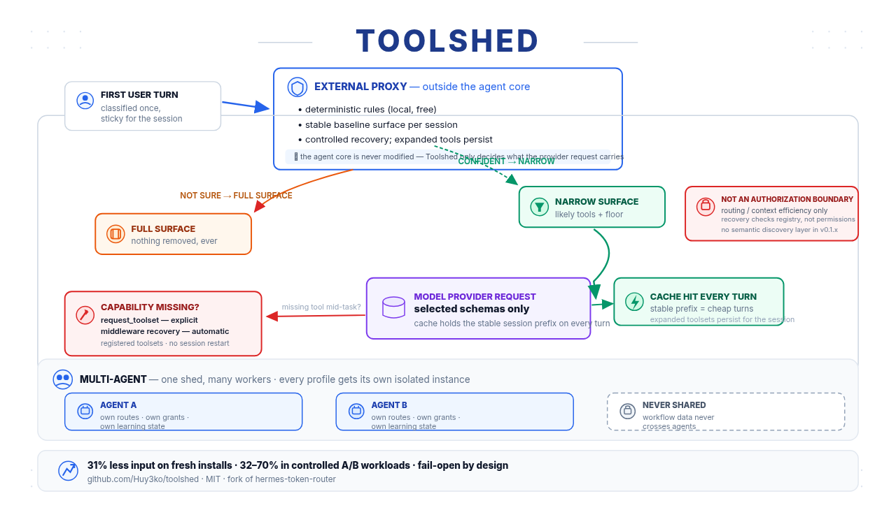

# Toolshed

<p align="center">
  <strong>Less tool overhead. Same agent capabilities.</strong>
</p>

<p align="center">
  An adaptive tool-surface proxy for Hermes that sends a smaller, relevant tool set to the model<br>
  while keeping missing capabilities reachable through Hermes' native recovery path.
</p>



## Measured results

| Test | Router OFF | Toolshed ON | Reduction |
| --- | ---: | ---: | ---: |
| Fresh GitHub canary run (single agent) | 15,263 input tokens | 8,696 input tokens | **43%** |
| Earlier controlled paired workloads | — | — | **24–70%** |

These are measured results, not a universal savings guarantee. Savings depend on the task, the
installed tool surface, routing confidence and the shape of the provider request. The validation
history — including experiments that were rejected — lives in [`adr/`](adr/).

## Why Toolshed?

Hermes agents accumulate dozens of tools, and every visible tool carries schema text into each
provider request — even when most of it is irrelevant to the current task.

Toolshed sits outside the agent core and reduces that surface before the request is sent:

- **Narrow when confident** — the likely working set plus protected floor tools go to the model.
- **Fail open when uncertain** — low confidence keeps the full surface instead of risking capability loss.
- **Recover when needed** — a missing toolset can be added mid-session through `request_toolset`, or automatically when the agent calls a registered-but-filtered tool (middleware recovery).
- **Keep agents isolated** — routes, grants, learning and telemetry stay profile-local.
- **No silent privileges** — Toolshed cannot touch the tool surface without Hermes' explicit `tools.override` grant.

### The core feature: authorized, per-request tool selection

The routing decision is not a heuristic that runs "sometimes". In v0.2.0 it is a controlled,
authorization-bound tool selection that runs on **every** provider request — including the
**first turn of a session**, which earlier versions could not reach.

- **Per LLM request, not per session.** The selection is computed for each provider request from
  the request's own intent, and it is intersected with the host's authorization. The result is
  written into that request's `tools` list; `agent.tools` is left untouched, so Hermes' own
  resolution of hidden tools and the recovery path stay intact.
- **Authorization-bound, never invented.** The effective tool set is
  `(predicted ∪ floor) ∩ available ∩ authorized`. Without a captured host authorization the router
  does not narrow at all — it keeps the full surface and says so in the log. Toolshed never widens
  what the host granted.
- **First turn included.** v0.1.x could only narrow from the second turn onward, because the
  hook that shortens the surface fires before the model has chosen a tool. v0.2.0 performs the
  selection at the `llm_request` stage, which runs inline with the agent on the stack — so the
  very first request of a session is already narrowed.
- **Every decision is logged with its reason.** `first-turn route applied at llm_request: 48 -> 11
  tools` names the size change; `llm_request kept full surface (reason=…)` names the reason the
  surface was *not* changed. A silent skip is not a valid state.

## Quick start

**About profiles:** Hermes calls each agent configuration a *profile*. If you run one agent,
that's `default`. With several agents, repeat these steps for every profile.

> **Important: install Toolshed from the `/runtime` subdirectory.** The repository root carries
> **three plugin manifests with the same plugin name** — `plugin.yaml`, `runtime/plugin.yaml` and
> `src/toolshed/plugin.yaml` — plus the development tree (ADRs, CI workflows, contributor docs, the
> test suite). Hermes scans a plugin directory by its **top-level** `plugin.yaml`, so a root install
> still registers exactly one plugin; the nested manifests are what the supply-chain scanner reports
> on. Measured with Hermes v0.22.2: the `/runtime` payload scans **clean** (verdict `safe`, 0
> findings) and installs without a prompt, while the repository root yields a `caution` verdict and
> asks for a confirmation. That prompt is avoidable, and the findings are noise from the
> development files, not from the plugin.
>
> **Never place a copy of the plugin tree inside the plugins directory.** Hermes registers *every*
> `plugin.yaml` it finds under `~/.hermes/plugins/`. A backup that is a **directory** next to the
> installed plugin is therefore loaded as a **second instance of the same plugin** — same plugin
> key, separate state (measured on Hermes v0.22.2: two manifests, both keyed
> `hermes-token-router`). Back up as a **file**, and preferably outside the plugins directory.
> The bundled updater does exactly that: it writes `<plugin>.config.preupdate.<stamp>` and
> `<plugin>.preupdate.<stamp>.tgz` — archive files, which the scanner does not register. The
> bundled `doctor.sh` reports the last backup and warns if a second instance has appeared.
>
> **Termux / Android:** this report originally came from a Termux user. The rule is the same
> there: install via `Huy3ko/toolshed/runtime`, never via the repo root. The installer and
> updater scripts require `bash` (Termux's default shell is fine; `sh`/busybox-only setups
> are not supported).

```bash
# 1. Install from the v0.2.0 release commit
hermes -p default plugins install Huy3ko/toolshed/runtime \
  --ref ad0f1bf38bd9236c041cad55de385147608c024e

# 2. Authorize the tool-surface override
hermes -p default plugins enable hermes-token-router --allow-tool-override
```

The grant lets Toolshed change **which already-authorized tools are visible to the model** — it does
not create new permissions. Installation and authorization are deliberately separate steps:
no grant, no routing.

```bash
# 3. Turn routing on — in the installed plugin's config.yaml:
#    global: enabled: true
```

Then verify:

```bash
hermes -p default plugins capabilities hermes-token-router
# → tools.override: granted
```

When routing is active you'll see `deterministic route reason=…` and `narrowed to N toolsets`
in the Hermes logs.

## How it works

1. The first user turn is classified; the result stays sticky for the session.
2. Confident prediction → only likely tools + floor stay visible. Uncertainty → full surface.
3. A missing capability mid-task? Native Hermes recovery adds that toolset on demand.

That's the whole mechanism. Details are in the diagram above and in the ADRs.

## Multiple agents

One profile = one agent = isolated state:

```bash
hermes -p coding plugins install Huy3ko/toolshed/runtime \
  --ref ad0f1bf38bd9236c041cad55de385147608c024e
hermes -p coding plugins enable hermes-token-router --allow-tool-override
```

Routes, grants, learning and telemetry are intended to remain profile-local. The
current source uses Hermes' profile home/context as the isolation key, but a
productive multiplex-gateway isolation run is still a release validation task.
Re-verify it after upstream profile-semantics changes.

## Update

```bash
hermes -p default plugins update hermes-token-router
```

**Shipped behavior:** the runtime updater preserves `global.enabled`, `mode`,
`floor_toolsets`, grants and the plugin tree when an update fails. It backs up as
**files next to the plugin directory** (`<plugin>.config.preupdate.<stamp>`,
`<plugin>.preupdate.<stamp>.tgz`) — never as a directory, because a directory
inside the plugins root would be registered by Hermes as a second instance of
the plugin (see the install note above). Prefer the
payload updater for a controlled update:

```bash
runtime/update.sh --profile default --ref ad0f1bf38bd9236c041cad55de385147608c024e
```

After updating, run the bundled doctor and check version/commit, grant,
`global.enabled` and `mode`:

```bash
runtime/doctor.sh --profile default
```

## Pinned installs & rollback

`plugins install owner/repo` follows the default branch — it does not automatically mean "latest
release". For reproducible deployments, pin the commit behind a release:

```bash
hermes -p default plugins install Huy3ko/toolshed/runtime \
  --ref <release-commit-sha> --force
```

Rollback works the same way with the previous release's commit SHA. One Git detail matters here:
annotated tags have their own object SHA — Hermes expects the **commit SHA behind the tag**.

## Uninstall

```bash
hermes -p default plugins remove hermes-token-router
```

Hermes keeps working without Toolshed. The upstream uninstaller may leave the grant entry in your
config — it doesn't keep anything running, but remove it if you don't want it retained for a possible
reinstall.

## Session semantics: stable baseline + controlled mid-session recovery

The router projects a narrow **baseline surface** at the start of a session (predicted working set
plus protected floor tools). This baseline is not re-routed arbitrarily mid-session — but a session
does **not** need to be restarted when an additional capability turns out to be needed later.

There are two defined recovery paths, and both take effect within the same session:

1. **Explicit — `request_toolset`.** A small escape-hatch tool that stays available after narrowing.
   The agent can request one or more registered toolsets by name, or resolve a known tool via its
   `tool_name` parameter. Expansion takes effect immediately and persists for the rest of the
   session. Unknown toolset names fail closed with closest-match suggestions and the list of
   available toolsets.
2. **Automatic — middleware recovery.** If the agent calls a *registered* tool that was filtered out
   of the current surface, middleware expands the owning toolset before dispatch so the original
   call executes instead of failing with "invalid tool". This is automatic recovery, not a new
   router projection and not explicit agent intent.

A successfully expanded toolset remains available for the remainder of the session.

> **What Toolshed is not:** Toolshed is a routing and context-efficiency layer, **not an
> authorization boundary**. The recovery paths check registry existence, not permissions — if the
> relevant tool/toolset is registered, it can be requested through the recovery path. Access control
> remains Hermes' job (plugin grants, tool approvals). Do not deploy Toolshed as a security
> perimeter.

There is no semantic discovery layer: a capability must be resolvable as a registered
toolset or tool name to be recovered. Controlled experiments with passive capability indexes showed
no measurable causal benefit over this recovery model, so it ships deliberately without one.

## Security model

Toolshed changes which tools the model sees, so its contract is explicit:

- **Fail-closed on authorization:** no `tools.override` grant → no surface manipulation.
- **Fail-open on routing uncertainty:** uncertainty keeps capabilities rather than removing them.
- **Recovery stays native:** missing registered capabilities can be recovered during the session
  (explicit `request_toolset` or automatic middleware recovery — see "Session semantics" above).
- **Floor policy is not content-controlled:** prompt or repository text cannot rewrite it.
- **Routing ≠ permission:** making a tool visible never creates permissions the agent didn't have.
  Recovery is limited to the agent's original Hermes-enabled toolsets and still
  relies on Hermes for final tool authorization.
- **Profile state stays isolated** across agents.

Adversarial testing covered manipulated repository content, read-only GitHub workflows, recovery,
stale capabilities and multi-profile isolation. See [SECURITY.md](SECURITY.md) for the full model
and how to report vulnerabilities.

## Hermes compatibility

| Hermes version | Status | Evidence |
| --- | --- | --- |
| **v0.22.2** | **Validated** | Installed and operated on a live gateway; the first-turn narrowing was measured in real gateway turns (`48 -> 11 tools`). |
| v0.21.x | Previous target | Superseded by v0.22.2; the v0.2.0 release is built and validated against v0.22.2. |

Toolshed is a plugin and does not modify the Hermes core. It relies on two documented host
surfaces: the `llm_request` middleware and the `tools.override` plugin grant. If a future Hermes
release changes either, the router degrades to the full tool surface and logs the reason — it never
silently narrows against an unknown host contract.

## Known limitations

- The routing floor (`floor_toolsets`) covers five toolsets, so the narrowed surface is stable at
  11 tools in most turns rather than being intent-sharp. The intent detection itself is precise
  (`git` → file + git + terminal, `browser` → web) but only acts above the floor. Whether the
  floor should be that broad is a configuration question, not a code question.
- Less permanent tool visibility can reduce spontaneous exploration; required capabilities remained
  recoverable in all validated tests.
- `plugins install owner/repo` follows the default branch, not the latest release tag. Pin with
  `--ref <commit-sha>` for reproducible deployments.
- The bundled installer/updater/doctor are deterministic shell helpers. A productive multi-profile
  lifecycle is validated, a full restart matrix across every host is not claimed here. The doctor
  resolves the `hermes` binary from the target home, so it reports on the installation you point
  it at — not on whichever `hermes` happens to be first in `PATH`.
- A genuine gateway restart was validated for this release; a host upgrade invalidates the
  compatibility statement above and requires a re-run of the acceptance checks.

## What changed in v0.2.0 (vs. v0.1.7)

- **First-turn routing.** The tool surface is now narrowed in the *first* request of a session,
  not from the second turn onward. v0.1.x could not do this: the shortening hook fires before the
  model has picked a tool, and the tool call is the only source of that knowledge.
- **The router actually routes.** In v0.1.x the agent was resolved by walking the call stack for
  an `agent` local. The hook that shortens the surface runs on a daemon worker where the caller's
  stack is truncated, so the walk could never succeed and every turn fell back to the full
  surface. The agent is now resolved through the session, with no global current agent, so
  parallel sessions never share one.
- **The flat plugin payload is importable again.** The repository root is the flat Hermes loader
  variant; a relative import without a package parent failed there, was swallowed by the
  exception handler, and silently produced zero dynamic MCP rules instead of four. The fallback is
  now in the file, and a subprocess probe covers the flat layout.
- **The configuration is no longer loaded with a hard `import yaml`.** PyYAML is not present in the
  Hermes host; the import failed, the configuration came back empty, and the router stayed silent.
  The loader now tries `yaml` → `ruamel.yaml` → `hermes_yaml`.
- **Refusal reasons are logged at a level the gateway shows.** Every fail-open path used to log on
  DEBUG, so a skipped narrowing looked identical to a successful one.
- **The provider message is measured correctly.** The middleware read the last user message from
  the request, which in Hermes carries the whole context wrapper (8910 characters for 98
  characters of user text), so the length guard always declined. The core's
  `original_user_message` is used instead.
- **Leading platform frames are stripped** before intent detection, so an inbound peer-agent
  wrapper no longer triggers the wrong capability.
- **A layer-mirror test** now enforces that the repository root, the package and the distribution
  payload stay byte-identical, and compares the file *lists* as well as the hashes.

## Configuration

Defaults are intentionally small:

```yaml
global:
  enabled: true            # router on/off
  mode: active             # active = route | shadow = observe only
  floor_toolsets:          # protected: never pruned
    - terminal
    - file
    - skills
    - memory
    - web

shadow:
  enabled: true            # profile-local learning bridge
```

Keep `floor_toolsets` small — everything on it rides along in every request. Per-profile overrides
live under `profiles.<name>` for advanced setups.

## For contributors

Architecture decisions, rejected mechanisms and validation history are documented, not hidden:
[`adr/`](adr/) · [`CHANGELOG.md`](CHANGELOG.md) · [`CONTRIBUTING.md`](CONTRIBUTING.md) ·
[`SECURITY.md`](SECURITY.md)

Project rule in one line:

> No mechanism gets added because it sounds good — only when a controlled test shows it's needed.

## Fork heritage & license

Toolshed is based on MIT-licensed `hermes-token-router` work by Jonathan Rivera (archived upstream)
and was substantially extended: dynamic MCP routing, compatibility work against current Hermes
upstream, lifecycle validation, security testing. See [`NOTICE`](NOTICE) and [`LICENSE`](LICENSE).

MIT.
